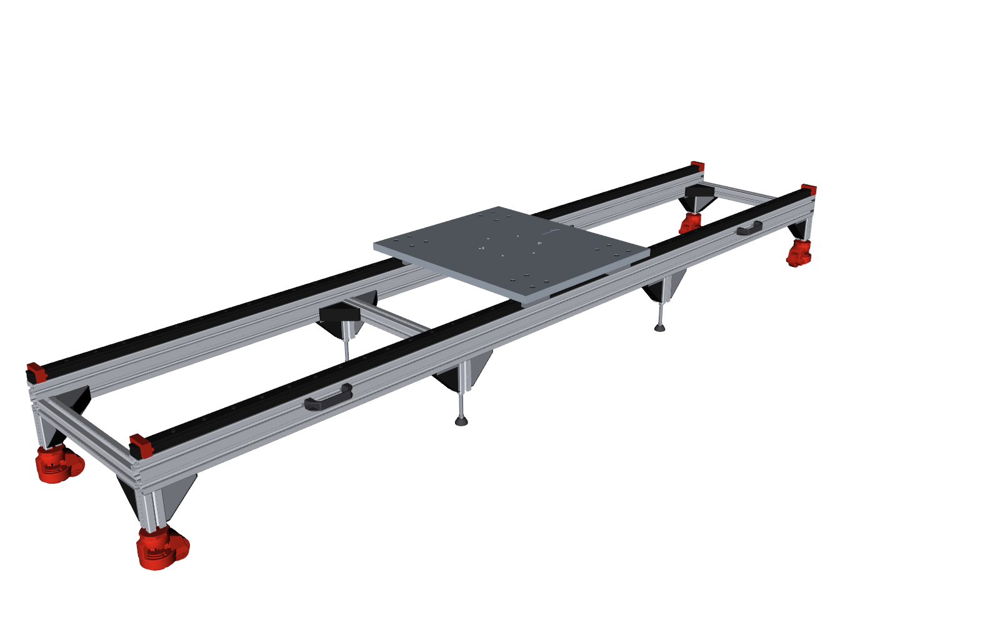

# Mehanički sklop – linearni rail za robota (7. osa), v3

Postolje dužine 3 m sa linearnim vođicama za FAIRINO FR20. Napravljeno je od Telix ALP aluminijumskih profila i Saier GD35 vođica, a ceo model se generiše kodom (CadQuery).



## Fajlovi

| Fajl | Sadržaj |
|---|---|
| `robot_rail_v3.stl` | ceo sklop kao jedan mesh (mm), za pregled |
| `robot_rail_v3.step` | STEP sklop: svaki deo je poseban imenovan i obojen čvor, delovi koji se ponavljaju upisani su jednom |
| `robot_rail_v3_BOM.xlsx` | BOM sa formulama (kurs i PDV u ćelijama E2/E3) |
| `robot_rail_v3_preview.png` | render prikazan gore |
| `src/gen_rail.py` | geometrija: postavlja Telix STEP delove i modeluje šine, kolica, stopere i ploču |
| `src/bom_data.py` | podaci za BOM: šifre, cene, linkovi, količine, napomene |
| `src/gen_bom.py` | pravi xlsx i osvežava BOM tabelu u ovom README-u |
| `src/render_asm.py` | renderi za proveru modela (VTK, bez ekrana) |

## Koordinatni sistem (STL / STEP)

- **X:** duž šina, tj. pravac kretanja. X = 0 je početak, kraj bez čepova.
- **Y:** poprečno.
- **Z:** nagore, Z = 0 je pod.
- **Početak:** na sredini između šina.

X osa baze robota poklapa se sa X osom raila. Na ploči je ugravirana strelica +X.

Visine od poda:

| Nivo | Visina |
|---|---|
| donja ivica nogu | 112 mm |
| vrh profila | 302 mm |
| vrh šine | 331 mm |
| vrh kolica | 350 mm |
| vrh ploče | 375 mm |

## Kratak opis konstrukcije

- **Glavni profili:** 2 × Telix 45x90 (ALP0047), 3000 mm, postavljeni na kant. Svetli razmak je 500 mm (osni 545 mm).
- **Vođice:** na gornjoj strani svakog profila je šina Saier GD35, pričvršćena vijcima DIN 912 M8x30 u klizne navrtke T10 na svakih 80 mm.
- **Kolica:** 4 × GD35WA, na razmaku od 400 mm duž X.
- **Distanceri:** 4 × 45x45 (ALP0045) dužine 500 mm, u donjih 45 mm profila. Prvi i poslednji su na samim krajevima, osni razmak je 985 mm. Drže ih 12 ugaonih spojnica ALP2137 sa poklopcima ALP2138.
- **Noge:** 8 × 45x45 × 100 mm, ispod distancera, svaka sa 2 × ALP2137.
  - Krajnje noge imaju jednu spojnicu na donjoj strani profila (ka sredini) i jednu na donjoj strani krajnjeg distancera.
- **Stope:**
  - Na krajnjim nogama su točkovi sa ugrađenom stopom ALP5527 (500 kg).
  - Na srednjim nogama su gumirane stope ALP2512 (1500 kg) na brezonu ALP2613 M12x100.
  - Jezgro nogu je narezano M12.
- **Ručke:** 4 × ALP4112 u gornjem spoljnom žlebu, između nogu 1–2 i 3–4.
- **Stoperi:** steznog tipa, preko prve i poslednje rupe šine. Vijak za stezanje ulazi u upust te rupe. Centar ploče može da se kreće od X ≈ 291 do X ≈ 2709 mm.
- **Ploča:** EN AW-5083, 700 × 600 × 25 mm.
  - 16 upuštenih rupa za M10 (kolica).
  - 6 × M10 sa navojem na krugu Ø210 za FR20.
  - 2 × Ø8 H7 prolazne rupe za čivije.

## Ponovno generisanje

```bash
python3 -m venv ~/cadenv && ~/cadenv/bin/pip install cadquery openpyxl   # jednom
cd mechanical_assembly/src
~/cadenv/bin/python gen_rail.py --step ../robot_rail_v3.step            # STL (+ STEP), oko 10 s
~/cadenv/bin/python gen_bom.py ../robot_rail_v3_BOM.xlsx --readme ../README.md
~/cadenv/bin/python render_asm.py . "../../3D modeli - Telix ALP katalog (1).zip" /tmp/rail   # renderi, po želji
```

- **Telix STEP modeli:** `gen_rail.py` ih čita direktno iz zvaničnog Telix ZIP-a.
  - ZIP traži u `mechanical_assembly/` i u korenu repoa; drugačija putanja se zadaje sa `--zip`.
  - ZIP se preuzima sa <https://www.telix.rs/wp-content/uploads/3D%20modeli%20-%20Telix%20ALP%20katalog.zip>.
- **Parametri konstrukcije** su konstante na vrhu `gen_rail.py`: dužina, razmak, dužina nogu, ploča, razmak kolica, raspored rupa za FR20.
- **Cene i količine** su u `bom_data.py`. Posle izmene ponovo pokreni `gen_bom.py`.

## Pogon – proračun motora i reduktora

Pogon X ose (zupčasta letva + zupčanik, motor na kolicima) još nije modelovan. Proračun ide redom, objašnjenja su komentari (`#`):

```bash
# ============================================================================
# 1. ULAZNI PODACI
# ============================================================================

# Masa koja se kreće (sve što je na kolicima):
#   robot 93 + teret 25 + ploča 28 + kolica 6 + motor i reduktor 12 + lanac i sitno 11
m = 175 kg

# Otpori kretanju:
#   trenje vođica, zaptivki i kablovskog lanca            ~100 N
#   rezerva za reakciju robota kad sam pomera ruku        ~250 N
otpori = 350 N

# Šta želimo:
a     = 5 m/s²            # ubrzanje
v_max = 2 m/s             # najveća brzina
g     = 9,81 m/s²         # gravitacija (treba za tačku 13)


# ============================================================================
# 2. ZUPČANIK NA KOSOJ LETVI (modul 2, ugao zuba 19°31'42")
# ============================================================================

# d = prečnik zupčanika (prečnik na kome zupčanik naleže na letvu)
# r = poluprečnik = d / 2    (krak na kome sila sa letve okreće osovinu)
# O = obim = π · d           (koliko kolica pređu za JEDAN obrtaj zupčanika)
# z = broj zuba

# Za kosu letvu modul 2 sa ovim uglom:  d = 2,1213 · z  [mm]
d_z15 = 2,1213 · 15 = 31,8 mm      r_z15 = 15,9 mm      O_z15 = π · 31,8 = 100 mm
d_z20 = 2,1213 · 20 = 42,4 mm      r_z20 = 21,2 mm      O_z20 = π · 42,4 = 133 mm
d_z30 = 2,1213 · 30 = 63,6 mm      r_z30 = 31,8 mm      O_z30 = π · 63,6 = 200 mm

# Kosi zubi: tiši i mirniji hod, više zuba je istovremeno u zahvatu, nose veću silu.
# Manji zupčanik: treba manji moment za istu silu, ali mora brže da se vrti.
# Ispod z15 se ne ide (zubi postaju slabi).


# ============================================================================
# 3. BRZINA = obrtaji zupčanika u sekundi · obim zupčanika
# ============================================================================

v = n_zupcanika / 60 · O                  # n u o/min, deli se sa 60 -> obrtaji u sekundi

# Primer: zupčanik direktno na motoru koji se vrti 3000 o/min:
v_z15 = 3000 / 60 · 0,100 m =  5,0 m/s
v_z20 = 3000 / 60 · 0,133 m =  6,7 m/s
v_z30 = 3000 / 60 · 0,200 m = 10,0 m/s

# -> Brzina NIJE problem. Problem je ubrzanje, a za ubrzanje treba sila.


# ============================================================================
# 4. SILA koju zupčanik mora da da letvi
# ============================================================================

F = m · a + otpori
F = 175 · 5 + 350 = 1 225 N               # ista za sve zupčanike


# ============================================================================
# 5. MOMENT NA ZUPČANIKU = sila · poluprečnik zupčanika
# ============================================================================

M_zupcanika = F · r
M_zupcanika_z15 = 1 225 N · 0,0159 m = 19,5 N·m
M_zupcanika_z20 = 1 225 N · 0,0212 m = 26,0 N·m
M_zupcanika_z30 = 1 225 N · 0,0318 m = 39,0 N·m


# ============================================================================
# 6. OSNOVNI POJMOVI O MOTORU
# ============================================================================

# n = broj obrtaja [o/min]
# ω = ugaona brzina [rad/s] = isti broj obrtaja, samo u jedinici za račun:
ω = 2 · π · n / 60
ω(3000 o/min) = 2 · 3,14 · 3000 / 60 = 314 rad/s
ω(1500 o/min) = 157 rad/s

# Snaga = moment · ugaona brzina:
P = M · ω            ->    M = P / ω

# U katalogu motora piše:
#   nominalna snaga i nominalni broj obrtaja (npr. 2 kW, 3000 o/min)
#   nominalni moment = moment koji motor daje STALNO, a da se ne pregreje
#   vršni moment     = moment koji motor daje KRATKO (~1 s), obično 3× nominalni.
#                      Taj se koristi za ubrzanje, jer ubrzanje traje kratko (~0,4 s).

# Primer, motor 2 kW / 3000 o/min:
M_nominalni = 2000 W / 314 rad/s = 6,4 N·m
M_vrsni     ≈ 3 · 6,4            = 19 N·m

# Iz M = P / ω sledi:
#   - ista snaga, više obrtaja    -> MANJI moment   (0,4 kW: 3000 o/min = 1,27 N·m,
#                                                            5000 o/min = 0,76 N·m)
#   - veća snaga, isti obrtaji    -> VEĆI moment
#   - servo daje svoj moment na svim brzinama do nominalnih obrtaja; iznad njih
#     moment opada, zato maksimalna brzina treba da bude na ~nominalnim obrtajima.

# Tipični servo motori 3000 o/min (M_nominalni = P / 314, M_vrsni ≈ 3×):
#   snaga     M_nominalni   M_vrsni
#   0,4 kW    1,3 N·m        3,8 N·m
#   0,75 kW   2,4 N·m        7,2 N·m
#   1 kW      3,2 N·m        9,5 N·m
#   1,5 kW    4,8 N·m       14,3 N·m
#   2 kW      6,4 N·m       19,1 N·m
#   3 kW      9,6 N·m       28,6 N·m
# Spori motori 1500 o/min imaju za istu snagu DUPLO veći moment (ω je duplo manja):
#   2 kW / 1500 o/min: 12,7 N·m nominalno, ~38 N·m vršno
#   3 kW / 1500 o/min: 19,1 N·m nominalno, ~57 N·m vršno

# Kako se bira motor (3 provere):
#   1) potreban vršni moment   ≤ M_vrsni motora       (da može da ubrza)
#   2) potreban stalni moment  ≤ M_nominalni motora   (da se ne pregreje)
#   3) potrebni obrtaji        ≤ nominalni obrtaji    (da stigne do v_max)
# Potreban stalni moment zavisi od toga koliko često ubrzava:
#   kolica stalno idu napred-nazad:          ≈ 0,7 · potreban vršni moment
#   robot radi nekoliko sekundi između:      ≈ 0,4 · potreban vršni moment


# ============================================================================
# 7. SNAGA POTREBNA ZA KRETANJE = sila · brzina
# ============================================================================

P = F · v
P = 1 225 N · 2 m/s = 2 450 W ≈ 2,5 kW    # na kraju ubrzanja: kolica idu 2 m/s, a
                                          # motor još gura punom silom (traje ~0,4 s)
# Ovo važi bez obzira na zupčanik i reduktor: reduktor ne menja snagu.
# Motor ovo daje svojom VRŠNOM snagom (~3× nominalna), pa nominalno treba bar ~1 kW.

# Zašto ne motor 0,4 kW na 5000 o/min?
#   vršna snaga ≈ 3 · 400 W = 1 200 W
#   pri 2 m/s može da gura najviše:   F = P / v = 1 200 / 2 = 600 N
#   ubrzanje:                         a = (F - otpori) / m = (600 - 350) / 175 = 1,4 m/s²
#   -> Koji god reduktor da staviš, snaga ostaje ista, pa ubrzanje ostaje ~1,4 m/s².
#      Više obrtaja ne pomaže, fale kilovati.


# ============================================================================
# 8. REDUKTOR: deli obrtaje, množi moment
# ============================================================================

# Od motora ka zupčaniku reduktor sa prenosom i:
n_zupcanika = n_motora / i                # obrtaji se DELE sa i
M_zupcanika = M_motora · i · 0,95         # moment se MNOŽI sa i (0,95 = 5 % gubitaka)

# Mi znamo koliki moment treba zupčaniku (tačka 5), pa tražimo koliko treba motoru.
# Isto jednačina, samo okrenuta:
M_motora = M_zupcanika / (i · 0,95)

# Provera na primeru: motor daje 8,2 N·m, reduktor i = 5:
M_zupcanika = 8,2 · 5 · 0,95 = 39 N·m     # isto kao M_zupcanika_z30 iz tačke 5


# ============================================================================
# 9. OPCIJA A – BEZ REDUKTORA (zupčanik direktno na osovini motora, i = 1)
# ============================================================================

# Obrtaji motora potrebni za v_max = 2 m/s:  n = v / O · 60
n_z15 = 2 / 0,100 · 60 = 1 200 o/min
n_z20 = 2 / 0,133 · 60 =   900 o/min
n_z30 = 2 / 0,200 · 60 =   600 o/min

# Vršni moment motora = moment zupčanika iz tačke 5 (+ ~10 % za ubrzanje rotora):
vrsni_z15 = 19,5 · 1,1 = 21 N·m
vrsni_z20 = 26,0 · 1,1 = 29 N·m
vrsni_z30 = 39,0 · 1,1 = 43 N·m

# Stalni moment (tačka 6: 0,4× sa pauzama ... 0,7× stalno napred-nazad):
stalni_z15 =  8 ... 15 N·m
stalni_z20 = 11 ... 20 N·m
stalni_z30 = 17 ... 30 N·m

# Motori od 3000 o/min ovde nemaju smisla: vrteli bi se samo 600–1200 o/min i
# koristili mali deo svoje snage. Zato spori motori (1500 o/min, tabela u tački 6):
#   z15 -> 2 kW / 1500 o/min (sa pauzama) ... 3 kW / 1500 o/min (stalno)
#   z20 -> 2 kW / 1500 o/min (sa pauzama) ... ~3,5 kW / 1500 o/min (stalno)
#   z30 -> 3 kW / 1500 o/min (sa pauzama) ... ~5 kW / 1500 o/min (stalno)
# -> Moguće je, ali motor mora SAM da da ceo moment: veliki, težak (12–20 kg) i skup
#    motor i drajver na kolicima. Ako bez reduktora, onda najmanji zupčanik, z15.


# ============================================================================
# 10. OPCIJA B – SA PLANETARNIM REDUKTOROM, motor 3000 o/min
# ============================================================================

# Korak 1: prenos tako da motor na 3000 o/min daje baš 2 m/s, ne više:
i = n_motora · O / (60 · v_max)
i_z15 = 3000 · 0,100 / (60 · 2) = 2,5   -> standardni reduktor: i = 3
i_z20 = 3000 · 0,133 / (60 · 2) = 3,3   -> standardni reduktor: i = 3
i_z30 = 3000 · 0,200 / (60 · 2) = 5,0   -> standardni reduktor: i = 5
# (planetarni reduktori se prave u odnosima 3, 4, 5, 7, 10 ...)

# Korak 2: koliko se tada vrti motor pri 2 m/s:  n_motora = v / O · 60 · i
n_z15 = 2 / 0,100 · 60 · 3 = 3 600 o/min    # iznad nominalnih 3000 -> moment tu opada
n_z20 = 2 / 0,133 · 60 · 3 = 2 700 o/min
n_z30 = 2 / 0,200 · 60 · 5 = 3 000 o/min

# Korak 3: moment motora (tačka 8), moment zupčanika iz tačke 5:
M_motora_z15 = 19,5 / (3 · 0,95) = 19,5 / 2,85 = 6,8 N·m
M_motora_z20 = 26,0 / (3 · 0,95) = 26,0 / 2,85 = 9,1 N·m
M_motora_z30 = 39,0 / (5 · 0,95) = 39,0 / 4,75 = 8,2 N·m

# Korak 4: tri provere iz tačke 6 (vršni +10 % za rotor, stalni 0,4× ... 0,7×):
#            vršni       stalni (pauze ... stalno)   motor (tabela u tački 6)
#   z15:     7,5 N·m     3,0 ... 5,2 N·m              1 kW (pauze) ... 2 kW (stalno)
#   z20:    10,0 N·m     4,0 ... 7,0 N·m              1,5 kW ... 3 kW
#   z30:     9,0 N·m     3,6 ... 6,3 N·m              1,5 kW ... 2 kW

# -> z30 + i = 5 je najbolji izbor: tačno 3000 o/min pri 2 m/s, standardni prenos,
#    najjači zupčanik. z15 + i = 3 bi trebalo da se vrti 3600 o/min (preko nominalnih).


# ============================================================================
# 11. ŠTA AKO UZMEM SLABIJI ILI JAČI MOTOR (z30 + i = 5)
# ============================================================================

# Najveća sila koju motor može da da letvi i ubrzanje koje iz nje sledi:
F_max = M_vrsni · i · 0,95 / r = M_vrsni · 5 · 0,95 / 0,0318 = M_vrsni · 149
a_max = (F_max - otpori) / m

#   motor     M_vrsni    F_max      a_max       stalno napred-nazad (treba ~6,3 N·m)?
#   0,75 kW    7,2 N·m   1 070 N    4,1 m/s²    ne (2,4 N·m) – i ne dostiže 5 m/s²
#   1 kW       9,5 N·m   1 420 N    6,1 m/s²    ne (3,2 N·m) – greje se i uz pauze
#   1,5 kW    14,3 N·m   2 140 N   10,2 m/s²    ne (4,8 N·m) – uz pauze da
#   2 kW      19,1 N·m   2 850 N   14,3 m/s²    da (6,4 N·m), tesno
#   3 kW      28,6 N·m   4 270 N   22,4 m/s²    da, sa velikom rezervom
# (stvarno ubrzanje je ~5–10 % manje jer motor ubrzava i svoj rotor)

# -> Slabiji motor: jeftiniji, ali manje ubrzanje ili pregrevanje pri stalnom radu.
#    Jači motor: veće ubrzanje, ali skuplji, a bez ankerisane baze ne možeš da
#    iskoristiš više od ~6 m/s² (tačka 13). Zato: 1,5 kW ako robot pravi pauze,
#    2 kW ako kolica stalno idu napred-nazad; 3 kW samo uz ankerisanu bazu.


# ============================================================================
# 12. KAKO REDUKTOR MENJA BRZINU I UBRZANJE (isti motor 2 kW, zupčanik z30)
# ============================================================================

v_max = 3000 / i / 60 · 0,2               # najveća brzina
F_max = 19,1 · i · 0,95 / 0,0318          # najveća sila na letvi
# Rotor motora se kroz reduktor vrti i puta brže, pa i njega treba ubrzati;
# to se oseća kao dodatna masa:  m_rotora = J · (i / r)²,  J ≈ 0,0006 kg·m² (2 kW)
a_max = (F_max - otpori) / (m + m_rotora)
# Vreme kretanja od s = 1 m:  t = s / v + v / a   (ako ne dostigne v: t = 2 · √(s / a))

#    i     v_max       F_max      m_rotora    a_max        kretanje od 1 m
#    1    10,0 m/s     570 N       0,6 kg     1,3 m/s²     1,79 s
#    3     3,3 m/s   1 711 N       5,3 kg     7,6 m/s²     0,73 s
#    5     2,0 m/s   2 851 N      14,8 kg    13,2 m/s²     0,65 s
#   10     1,0 m/s   5 702 N      59,3 kg    22,8 m/s²     1,04 s

# -> Bez reduktora: ogromna brzina, ali mala sila, pa sporo ubrzava.
#    Previše reduktora: velika sila, ali mala brzina.
#    Najbrže: motor na nominalnim obrtajima daje baš potrebnu brzinu (ovde i = 5).


# ============================================================================
# 13. DA LI ĆE BAZA DA SE POMERI (ako NIJE ankerisana u pod)
# ============================================================================

# Kad motor gura kolica napred, ista sila gura bazu nazad (akcija = reakcija).
# Bazu na mestu drži samo trenje stopa o pod:
#   F_trenja = μ · (ukupna masa) · g
#   μ ≈ 0,5   (koeficijent trenja gume o beton, procena na sigurnoj strani)
#   ukupna masa = kolica 175 kg + baza 95 kg = 270 kg
F_trenja = 0,5 · 270 · 9,81 = 1 324 N

# Bazu gura nazad:  m · a + reakcija robota (250 N)
# (trenje u vođicama ne gura bazu – ono deluje između kolica i baze)
# Baza miruje dok je:  m · a + 250 ≤ 1 324
a_klizanja = (1 324 - 250) / 175 ≈ 6 m/s²

# -> Do ~6 m/s² baza stoji sama. Za više od toga bazu treba ankerisati u pod.


# ============================================================================
# 14. ZAKLJUČAK
# ============================================================================

# Bez reduktora:  z15 + spori servo 2–3 kW / 1500 o/min.
#                 Nema zazora reduktora, ali je motor težak (12–20 kg) i skup.
# Sa reduktorom:  z30 + planetarni i = 5 + servo 3000 o/min:            <- PREPORUKA
#                   1,5 kW ako robot između pomeranja radi (pauze),
#                   2 kW ako kolica stalno idu napred-nazad.
#                 2 m/s i 5 m/s² dok baza stoji na stopama;
#                 sa ankerisanom bazom i 2 kW motorom i 8–10 m/s².
# Uz to:          spoljni kočioni otpornik ~500 W, drajver 3 × 400 V,
#                 apsolutni enkoder, kočnica + STO.
# Podaci motora su tipični; konačna provera sa katalogom izabranog motora.
```

## Kandidati za pogon (za odluku)

Proračun je urađen za motor **Leadshine ELM2M-2000LB130E-H** (2 kW, sa kočnicom) sa drajverom **EL7-EC2000N** (EtherCAT CiA 402, CSP, STO), dobavljač [Power Belt](https://www.powerbelt.rs/leadshine-servo-sistemi). Podaci motora: nominalni / vršni moment 7,7 / 22 N·m, nominalno 2.500 o/min, maksimalno 2.800 o/min, rotor 16,8·10⁻⁴ kg·m².

Uslovi proračuna: masa koja se kreće **150 kg**, otpori 350 N, ciljna brzina 2 m/s, ubrzanje 5 m/s².

### Četiri kandidata

| | z15 bez reduktora | z20 + i = 3 | z30 + i = 3 | z30 + i = 4 |
|---|---|---|---|---|
| obrtaji motora pri 2 m/s | 1.200 ✔ | 2.700 ⚠ (preko nominalnih) | 1.800 ✔ | 2.400 ✔ |
| najveća brzina sa punim momentom | 4,17 m/s | 1,85 m/s | 2,78 m/s | 2,08 m/s |
| potreban vršni moment / motor ima 22 | 19,2 ✔ (tesno) | 9,0 ✔ | 13,5 ✔ | 10,1 ✔ |
| najveće ubrzanje (motor) | 6,6 m/s² | 14,2 m/s² | 9,8 m/s² | 12,9 m/s² |
| stalni moment sa pauzama / motor ima 7,7 | 7,7 ⚠ granica | 3,6 ✔ | 5,4 ✔ | 4,1 ✔ |
| stalni moment, stalno napred-nazad | 13,5 ✘ | 6,3 ✔ | 9,5 ✘ | 7,1 ✔ |
| odnos inercija | 23 ⚠ | 4,5 ✔ | 10 ✔ | 5,6 ✔ |
| ocena | slabo | dobro | **najbrže uz pauze** | **sve prolazi** |

Svi momenti su u N·m.

**Odnos inercija** = koliko je teret "težak" za rotor motora: `J_tereta / J_rotora`, gde je `J_tereta = m · (r / i)²`.
- Ispod 10 je dobro.
- Od 10 do 30 je prihvatljivo.
- Preko 30 je loše: ljuljanje, sporo smirivanje u poziciji.
- Reduktor ga smanjuje sa kvadratom prenosa (i²).

Napomena za varijantu bez reduktora: zupčanik mora biti na posebnoj osovini u ležajevima. Bočna sila od oko 1.180 N i uzdužna od oko 390 N su veće od onog što vratilo motora dozvoljava (490 N i 196 N).

### Trka – vreme kretanja od mirovanja do zaustavljanja [s]

Svaka udaljenost je posebno kretanje. Brzina je ograničena na najveću brzinu sa punim momentom (red iz tabele iznad).

**Baza ankerisana u pod** (svaki kandidat koristi puno ubrzanje motora; važi i za rail od 3 m i od 6 m):

| udaljenost | z15 bez | z20 + i3 | z30 + i3 | z30 + i4 |
|---|---|---|---|---|
| 0,5 m | 0,55 | **0,40** | 0,45 | **0,40** |
| 1,0 m | 0,78 | 0,67 | **0,64** | **0,64** |
| 1,5 m | 0,95 | 0,94 | **0,82** | 0,88 |
| 2,0 m | 1,10 | 1,21 | **1,00** | 1,12 |
| 2,5 m | 1,23 | 1,48 | **1,18** | 1,36 |
| 3,0 m | **1,35** | 1,75 | 1,36 | 1,60 |
| 3,5 m | **1,47** | 2,02 | 1,54 | 1,84 |
| 4,0 m | **1,59** | 2,29 | 1,72 | 2,08 |
| 4,5 m | **1,71** | 2,56 | 1,90 | 2,32 |
| 5,0 m | **1,83** | 2,83 | 2,08 | 2,57 |
| 5,5 m | **1,95** | 3,10 | 2,26 | 2,81 |
| 6,0 m | **2,07** | 3,37 | 2,44 | 3,05 |

**Baza bez ankera, rail 3 m** (baza ~95 kg, ubrzanje ograničeno na ~6,3 m/s² da baza ne klizi):

| udaljenost | z15 bez | z20 + i3 | z30 + i3 | z30 + i4 |
|---|---|---|---|---|
| 0,5 m | **0,56** | **0,56** | **0,56** | **0,56** |
| 1,0 m | **0,80** | 0,83 | **0,80** | 0,81 |
| 1,5 m | **0,98** | 1,10 | **0,98** | 1,05 |
| 2,0 m | **1,13** | 1,37 | 1,16 | 1,29 |
| 2,5 m | **1,26** | 1,64 | 1,34 | 1,53 |
| 3,0 m | **1,38** | 1,91 | 1,52 | 1,77 |

**Baza bez ankera, rail 6 m** (baza ~180 kg, ubrzanje ograničeno na ~9,1 m/s²):

| udaljenost | z15 bez | z20 + i3 | z30 + i3 | z30 + i4 |
|---|---|---|---|---|
| 0,5 m | 0,55 | **0,47** | **0,47** | **0,47** |
| 1,0 m | 0,78 | 0,74 | **0,66** | 0,71 |
| 1,5 m | 0,95 | 1,01 | **0,84** | 0,95 |
| 2,0 m | 1,10 | 1,28 | **1,02** | 1,19 |
| 2,5 m | 1,23 | 1,55 | **1,20** | 1,43 |
| 3,0 m | **1,35** | 1,82 | 1,38 | 1,67 |
| 3,5 m | **1,47** | 2,09 | 1,56 | 1,91 |
| 4,0 m | **1,59** | 2,36 | 1,74 | 2,15 |
| 4,5 m | **1,71** | 2,64 | 1,92 | 2,39 |
| 5,0 m | **1,83** | 2,91 | 2,10 | 2,63 |
| 5,5 m | **1,95** | 3,18 | 2,28 | 2,87 |
| 6,0 m | **2,07** | 3,45 | 2,46 | 3,11 |

### Zaključak za odluku

- **Kratka i srednja kretanja (do ~2,5 m):** najbrži je **z30 + i = 3**, ali samo ako robot pravi pauze između pomeranja.
- **Kolica stalno idu napred-nazad:** **z30 + i = 4**. Prolazi sve provere, a najveća brzina mu je oko 2,1–2,3 m/s.
- **Duga kretanja (preko ~3 m):** z15 bez reduktora pobeđuje samo na papiru. Pregreva se pri stalnom radu, ima loš odnos inercija, a 4 m/s je preko onoga što dozvoljavaju FR20 (2 m/s na vrhu alata) i bezbednost.
- **Ako se rail produži i treba ≥ 3 m/s:** razmotriti motor od 3.000 o/min (Inovance SV660N + MS1H2-20C30CD ili Delta B3A + ECM-B3M) sa z30 + i = 3. Daje ~3,3 m/s sa punim momentom.

**Kandidati za motor i drajver** (svi EtherCAT, CiA 402, CSP, STO):
- **Leadshine** EL7-EC2000N + ELM2M-2000LB130E-H, Power Belt (RS). Najpovoljniji i domaći; nema javnu ROS 2 konfiguraciju.
- **Inovance** SV660NT8R4I + MS1H2-20C30CD (3.000 o/min), Inovance Mađarska. Ima javnu konfiguraciju za `ethercat_driver_ros2`.
- **Delta** ASD-B3A-2023-E + ECM-B3M-CA1020SS1 (3.000 o/min), EP-Solutions Beograd.
- **Omron** R88D-1SN20H-ECT + R88M-1M2K020T-BS2 (2.000 o/min, enkoder bez baterije), Mikro Kontrol Beograd. Najskuplji od četiri.

## Otvorena pitanja pre naručivanja / obrade

- **Baza FR20:** raspored rupa (6 × Ø10,5 na Ø210), rupa i žleb za čivije Ø8 i prirubnica od 25 mm izmereni su iz `fairino_description/meshes/fairino20_v6/base_link.STL`. Treba ih proveriti na zvaničnom FAIRINO crtežu.
- **Telix:** potvrditi da li ALP2511 ima gumenu podlogu; to je jača alternativa za ALP2512.
- **Mehatron:** tražiti simetrično sečenje šine (E = 20 mm) i klasu prednaprezanja / tačnosti.
- **Stoperi:** za veličinu 35 ih nema u Srbiji. U BOM-u su uvozni stezni graničnici, koji nisu udarni.
- **CNC obrada ploče:** samo po ponudi, nije uračunata u ukupnu cenu.

## Alternative za srednje stope (za odluku)

Trenutno su izabrane Telix ALP2512 (Ø39, gumena podloga, 1500 kg) na brezonu ALP2613. Rade posao, ali imaju malu površinu oslanjanja. Alternative su istražene 17.10.2026.

**Smernice:**
- **Nosivost nije problem.** Oko 200 kg je na 8 oslonaca, pa svaka opcija ima 10 i više puta veću nosivost od potrebne.
- **Krutost je važnija od amortizacije.** Meki elementi puštaju bazu da se ljulja kada robot ili rail ubrzava.
- **Bolja je tanka, tvrda NBR guma** (80–90 Shore A) zbog trenja, a gde god može treba ankerisati u pod.
- **Navoj mora biti standardni M12** (korak 1,75), kao narezano jezgro Telix profila. Fini navoj M12×1,25 ne odgovara.
- **Srednje noge mogu da se produže.** Tih 4 noge su posebni komadi, pa im se dužina prilagođava visini izabrane stope. Sada je donja ivica nogu na 112 mm, zbog točkova.

| Opcija | Prečnik / navoj | Nosivost | Cena | Gde | Napomena |
|---|---|---|---|---|---|
| **GET-TH pocinkovana antivibraciona stopa, NBR 80 Sh-A** (preporuka) | Ø120, M12×70 / 100 / 150 | 600 kg | 2.159–2.292 RSD | [FullTech (RS)](https://fulltech.rs/Pocinkovana-antivibraciona-stopala--get-th--/proizvod/1485/) | najveća površina, domaća zamena za Movet; rok na upit. Ø80 M12×100 (800 kg, 2.680 RSD) za 2 dana |
| Tecom TCM91-90 inox antivibraciona stopa, NBR 90 Sh-A | Ø95, M12×70 | 1700 kg | 4.384 RSD | [FullTech (RS)](https://fulltech.rs/Nerdajuca-antivibraciona-stopala--tcm91-90--/proizvod/1486/) | tvrđa guma, pa krutija; 3–5 dana |
| MNX zglobna gumena stopa sa rupama za ankere | Ø75, M12×90 / 130 | 700 kg | 1.241–1.315 RSD | [FullTech (RS)](https://fulltech.rs/Zglobasto-gumeno-stopalo-za-ankerisanje--mnx---/proizvod/1496/) | guma i ankerisanje u pod |
| ALCO „Elastična stopa Ø120" (stopa sa klinom za nivelaciju) | Ø120, navoj nije naveden | 8,5 kN | 5.601 RSD sa PDV | ALCO (RS) | vrlo kruta, fina nivelacija; proveriti da li je M12 |
| Movet antivibraciona Ø100 pocinkovana (10586) / Ø84 čelik (4826) | Ø100 / Ø84, M12×75 | 9 kN / 6 kN statički | 13,65 € / 23,04 € bez PDV | [Movet (DE)](https://www.movet.eu/en/machine-feet/levelling-elements/anti-vibration-levelling-feet/10586/levelling-foot-antivibration-oe-100-mm-galvanized-steel-m12-x-75-mm-incl.-nut-nbr) | **ne šalju u Srbiju** (samo EU/CH/NO, samo firme); izvozna ponuda (info@movet.de) ili špediter u HU/HR |
| Telix ALP2511 Stopa fi75 na ALP2613 | Ø75, isti brezon | 3000 kg | 4,84 € | Telix | ima 2 rupe Ø9 za ankere; guma se vidi samo u Telix STEP-u, ne u katalogu, pa potvrditi sa Telix-om |

**Ankerisanje u pod** (najkruće rešenje, radi sa svakom stopom koja ima rupe):
- ankeri M10, npr. Fischer FAZ II 10/20, oko 170–210 RSD po komadu (etaz.rs, promont.rs),
- najmanje krajnje pozicije, posle nivelacije.

**Ne preporučuje se za bazu robota:**
- meki gumeni amortizeri (VP/VE), Sylomer / Sylodyn podloge, debele podloške od plute ili gume, jer dodaju ljuljanje,
- stope sa AliExpress-a i Temu-a, jer nijedna nema proverljivu nosivost po stopi.

## BOM

Cene su proverene 17.10.2026. Telix cene su u EUR bez PDV-a. Pune specifikacije i napomene su u xlsx fajlu.

<!-- BOM:START -->
| | bez PDV | sa PDV (20%) |
|---|---:|---:|
| **Ukupno RSD** | **146 097,20** | **175 316,63** |
| **Ukupno EUR** (kurs 117.3931) | 1 244,51 € | 1 493,42 € |

CNC obrada ploče kolica nije uračunata (po ponudi).

| # | Šifra | Naziv | Dobavljač | Kol. | Jed. | Cena / jed. | Ukupno RSD bez PDV | Ukupno RSD sa PDV |
|---|---|---|---|---:|---|---:|---:|---:|
| | | **A. Aluminijumski profili i usluge – Telix ALP sistem (cene EUR bez PDV, katalog mart 2026)** | | | | | | |
| 1 | ALP0047 | [Profil 45x90](https://www.telix.rs/wp-content/uploads/katalog.pdf#page=20) | Telix (Novi Sad) | 6 | m | 19,13 EUR bez PDV | 13 474,38 | 16 169,26 |
| 2 | ALP0045 | [Profil 45x45](https://www.telix.rs/wp-content/uploads/katalog.pdf#page=18) | Telix (Novi Sad) | 2,8 | m | 10,19 EUR bez PDV | 3 349,46 | 4 019,35 |
| 3 | USL-SEC | [Sečenje na meru – doplata 10%](https://www.telix.rs/wp-content/uploads/katalog.pdf#page=18) | Telix (Novi Sad) | 1 | paušal | 334,95 RSD bez PDV | 334,95 | 401,94 |
| 4 | USL-REZ | [Sečenje – rez](https://www.telix.rs/wp-content/uploads/katalog.pdf#page=18) | Telix (Novi Sad) | 12 | rez | 0,60 EUR bez PDV | 845,23 | 1 014,28 |
| | | **B. Spojni elementi – Telix** | | | | | | |
| 5 | ALP2137 | [Ugaona spojnica 45-visoka (Vis. sp. za 45x45)](https://www.telix.rs/wp-content/uploads/katalog.pdf#page=80) | Telix (Novi Sad) | 28 | kom | 5,09 EUR bez PDV | 16 730,86 | 20 077,04 |
| 6 | ALP2138 | [Poklopac 45 (za ugaonu spojnicu 45-visoku)](https://www.telix.rs/wp-content/uploads/katalog.pdf#page=80) | Telix (Novi Sad) | 28 | kom | 1,46 EUR bez PDV | 4 799,03 | 5 758,84 |
| 7 | ALP0175 | [Vijak M8x20](https://www.telix.rs/wp-content/uploads/katalog.pdf#page=30) | Telix (Novi Sad) | 112 | kom | 0,19 EUR bez PDV | 2 498,13 | 2 997,75 |
| 8 | ALP0643 | [Klizna navrtka M8 T10](https://www.telix.rs/wp-content/uploads/katalog.pdf#page=38) | Telix (Novi Sad) | 196 | kom | 0,30 EUR bez PDV | 6 902,71 | 8 283,26 |
| 9 | ALP4017 | [Poklopac 45x90 (čep)](https://www.telix.rs/wp-content/uploads/katalog.pdf#page=157) | Telix (Novi Sad) | 2 | kom | 0,85 EUR bez PDV | 199,57 | 239,48 |
| 10 | ALP4112 | [Ručka 120](https://www.telix.rs/wp-content/uploads/katalog.pdf#page=132) | Telix (Novi Sad) | 4 | kom | 1,87 EUR bez PDV | 878,10 | 1 053,72 |
| | | **C. Točkovi i stope – Telix** | | | | | | |
| 11 | ALP5527 | [Točak sa stopom CD80 (Toč. sa sto. CD80)](https://www.telix.rs/wp-content/uploads/katalog.pdf#page=182) | Telix (Novi Sad) | 4 | kom | 11,50 EUR bez PDV | 5 400,08 | 6 480,10 |
| 12 | ALP2512 | [Stopa fi39 Al (gumena podloga)](https://www.telix.rs/wp-content/uploads/katalog.pdf#page=170) | Telix (Novi Sad) | 4 | kom | 2,55 EUR bez PDV | 1 197,41 | 1 436,89 |
| 13 | ALP2613 | [Brezon M12x100](https://www.telix.rs/wp-content/uploads/katalog.pdf#page=171) | Telix (Novi Sad) | 4 | kom | 2,61 EUR bez PDV | 1 225,58 | 1 470,70 |
| | | **D. Linearno vođenje – Mehatron (cene RSD sa PDV)** | | | | | | |
| 14 | 550010 | [Profilisana šina GD35 (Saier), dužina 300 cm](https://mehatron.rs/profilisana-sina-gd35) | Mehatron (Kragujevac) | 2 | kom | 25 200,00 RSD sa PDV | 42 000,00 | 50 400,00 |
| 15 | 550085 | [Kolica za profilisanu šinu GD35WA (Saier) – široka, sa prirubnicom](https://mehatron.rs/kolica-za-profilisanu-sinu-gd35wa) | Mehatron (Kragujevac) | 4 | kom | 5 280,00 RSD sa PDV | 17 600,00 | 21 120,00 |
| 16 | HG35-LIM | [Stoper (graničnik) za šinu veličine 35 – 'HG35 limit block' sa gumenim odbojnicima](https://www.aliexpress.com/item/1005013023414852.html) | AliExpress (uvoz) | 4 | kom | 983,00 RSD bez PDV | 3 932,00 | 4 718,40 |
| | | **E. Ploča kolica (nosač robota FR20)** | | | | | | |
| 17 | PL-5083-25 | [Aluminijumska brušena ploča EN AW-5083, 25 mm – isečena na 700 × 600 mm](https://prodajametala.rs/proizvod/aluminijum-brusena-ploca-1500x3000mm-t25-en-aw-5083) | Prodaja Metala (Novi Sad) | 27,9 | kg | 780,00 RSD bez PDV | 21 762,00 | 26 114,40 |
| 18 | CNC-PLOCA | [CNC obrada ploče kolica (po crtežu)](https://deltatehnik.rs/usluga/usluga-glodanja/) | po ponudi (npr. Delta Tehnik Marold, Novi Sad) | 1 | kom | 0,00 RSD bez PDV | 0,00 | 0,00 |
| 19 | 00841030 | [Vijak cilindrične glave imbus DIN 912 M10x30, 8.8, pocinkovan](https://eshop.wurth.rs/vijak-cilind-gl-imbus-din-912-c-poc-8-8-m10x30-vijci-i-vijcane-veze) | Würth Srbija | 16 | kom | 48,00 RSD sa PDV | 640,00 | 768,00 |
| 20 | 00841050 | [Vijak cilindrične glave imbus DIN 912 M10x50, 8.8, pocinkovan](https://eshop.wurth.rs/vijak-cilind-gl-imbus-din-912-c-poc-8-8-m10x50-vijci-i-vijcane-veze) | Würth Srbija | 6 | kom | 41,00 RSD sa PDV | 205,00 | 246,00 |
| 21 | 11980024 | [Cilindrična čivija DIN 6325 m6 Ø8 × 24](https://ami.rs/proizvod/cilindricna-civija-din-6325-m6-8x24) | AMI d.o.o. | 2 | kom | 41,62 RSD sa PDV | 69,37 | 83,24 |
| | | **F. Vijci za šine i ručke** | | | | | | |
| 22 | 0084830 | [Vijak cilindrične glave imbus DIN 912 M8x30, 8.8, pocinkovan](https://eshop.wurth.rs/vijak-cilind-gl-imbus-din-912-c-poc-8-8-m8x30-vijci-i-vijcane-veze) | Würth Srbija | 76 | kom | 30,00 RSD sa PDV | 1 900,00 | 2 280,00 |
| 23 | 0084820 | [Vijak cilindrične glave imbus DIN 912 M8x20, 8.8, pocinkovan](https://eshop.wurth.rs/vijak-cilind-gl-imbus-din-912-c-poc-8-8-m8x20-vijci-i-vijcane-veze) | Würth Srbija | 8 | kom | 23,00 RSD sa PDV | 153,33 | 184,00 |
| | | **UKUPNO (RSD)** | | | | | **146 097,20** | **175 316,63** |
| | | **UKUPNO (EUR, kurs 117.3931)** | | | | | **1 244,51 €** | **1 493,42 €** |
<!-- BOM:END -->
